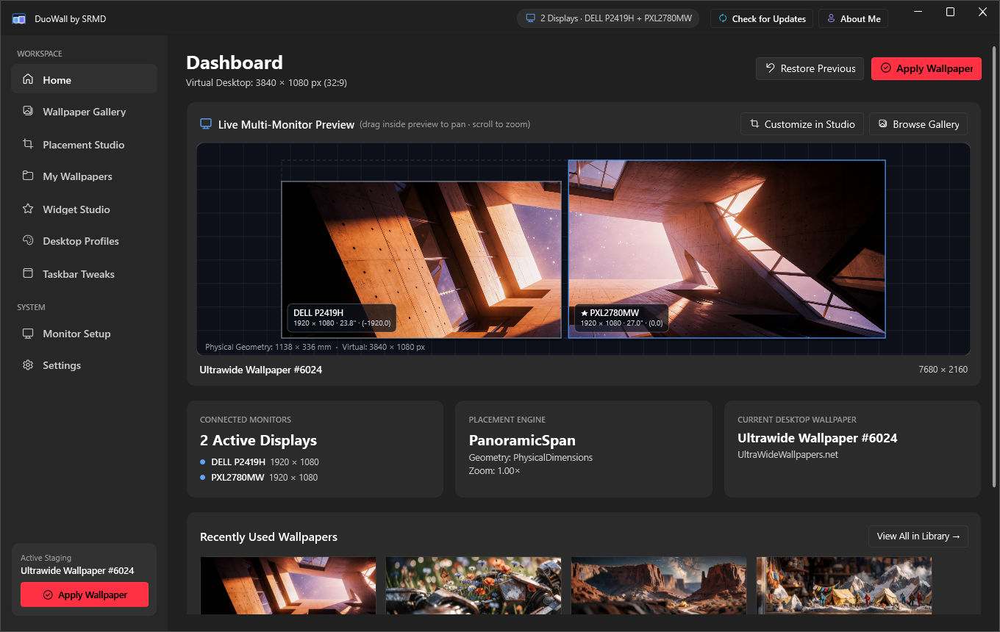
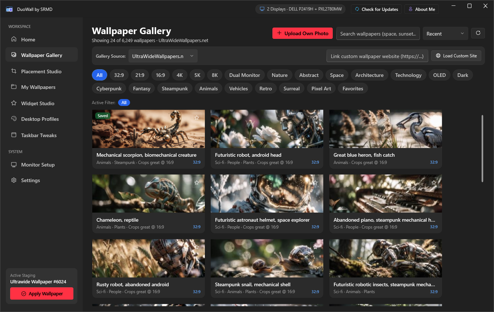
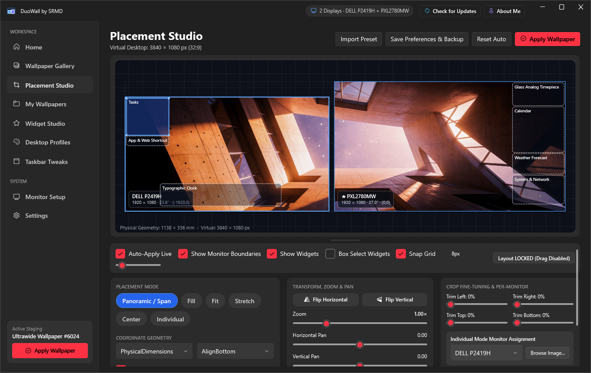
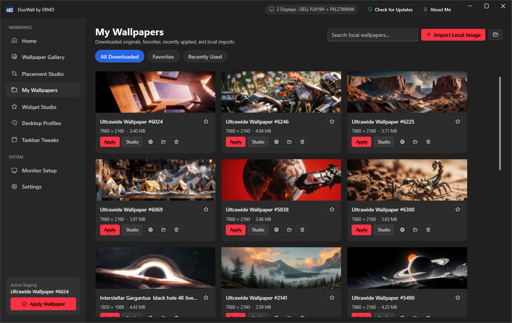
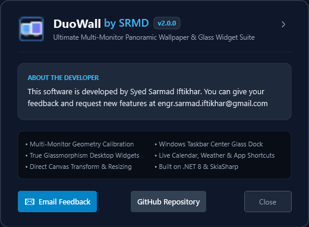

# DuoWall by SRMD (v2.0.0)

**Ultimate Multi-Monitor Panoramic Wallpaper Manager, Glassmorphism Widget Suite & Windows Taskbar Dock**

Developed by **Syed Sarmad Iftikhar**  
*Feedback & Feature Requests:* [engr.sarmad.iftikhar@gmail.com](mailto:engr.sarmad.iftikhar@gmail.com)  
*GitHub Repository:* [https://github.com/xarmad19/DuoWall](https://github.com/xarmad19/DuoWall)

---

## 📸 Visual Showcase

| Wallpaper Gallery | Placement Studio (Transform Handles) |
| :---: | :---: |
|  |  |

| Widget Marketplace & Glass Suite | Taskbar Tweaks (Center Glass Dock) |
| :---: | :---: |
|  |  |

| About Me & Developer Info |
| :---: |
|  |

---

## 🚀 What's New in Version 2.0.0

- **Placement Studio Direct Transforms**:
  - Direct canvas interactive transform with 8 bounding box resize handles (`NW`, `N`, `NE`, `E`, `SE`, `S`, `SW`, `W`).
  - Anchored opposite-edge resizing, click-and-drag panning, and mouse-wheel zooming.
  - Auto-applies live wallpaper framing to the Windows desktop on mouse release.
  - Multi-widget selection via single click, `Ctrl/Shift+Click`, or marquee rubber-band box drag.
  - Group drag-and-move for multiple selected widgets with relative spacing and snap-to-grid.
  - Resizable monitor preview viewport with full multi-monitor aspect ratio preservation.
  - Complete workspace profile backup and import/export.

- **Taskbar Tweaks & Center Glass Dock**:
  - Automatically detects running taskbar application buttons via UIAutomation & MSAA accessibility.
  - Centers a sleek, translucent glass dock pill directly behind active buttons on Windows 10 & 11.
  - Dynamic dock width and height sliders.
  - Smooth auto-hide tracking synchronized with Windows taskbar animations.
  - Multi-display taskbar visibility controls (all displays or chosen display).

- **Widget Marketplace & Glass Desktop Widgets**:
  - Renamed tab to **Widget Marketplace** with direct "Edit" button for active widgets.
  - Universal Accent Color picker with **"Auto Accent from Wallpaper"** smart color extraction.
  - Enhanced **Full-Month Calendar Widget**: Monday week start, prominent smooth translucent today indicator, weekend/holiday highlights, month navigation arrows, and click-to-schedule interactive Events, Reminders & Notes dialog with audio alarms.
  - **App, Folder & Web Shortcuts Dock Bar**: smart glass icon or initials mode, custom icon image upload (with clean borderless icon display), scale slider (`0.45×` - `2.50×`), hover tooltips, and **Windows Installed Apps Picker** (Store/UWP, Start Menu, Registry App Paths).
  - **Typographic Clock**: Per-element font selector with live previews, visibility toggles, custom accent colors, individual and master scaling, and drop-shadow control.
  - Customizable **Focus Timer** and minimal animated **Weather Widget**.

- **Wallpaper Gallery Upgrades**:
  - **Upload Custom Photos** with dual-monitor aspect-ratio and resolution warnings.
  - **Custom Ultra-Wide Website Linking** to scrape and stream wallpapers from any ultra-wide wallpaper website.

- **Top Navigation Menu**:
  - **About Me**: Top title bar button displaying developer information and feedback channel:
    > *"This software is developed by Syed Sarmad Iftikhar. You can give your feedback and request new features at engr.sarmad.iftikhar@gmail.com"*
  - **Check for Updates**: Direct GitHub Release query notifying users of newer versions without background silent downloads.

- **Release Packaging**:
  - Windows Setup Installer: `DuoWall-v2.0.0-Setup.exe` (Inno Setup 6).
  - Standalone Portable Zip: `DuoWall-v2.0.0-win-x64-Portable.zip`.
  - Cryptographic checksums in `publish/SHA256SUMS.txt`.

---

## 🛠️ System Requirements

- **Operating System**: Windows 10 (Build 19045 or later) or Windows 11 (64-bit).
- **Monitors**: Dual, Triple, or Ultra-Wide multi-monitor setups (also supports single-screen displays).
- **Hardware Acceleration**: DirectX 11 / Direct3D compatible GPU recommended for SkiaSharp compositor and DWM glass effects.

---

## 📦 Installation & Download

### Option 1: Setup Installer (Recommended)
1. Download **`DuoWall-v2.0.0-Setup.exe`** from [GitHub Releases](https://github.com/xarmad19/DuoWall/releases).
2. Run the installer and choose whether to create desktop or startup shortcuts.

### Option 2: Portable Distribution (Zero Installation)
1. Download **`DuoWall-v2.0.0-win-x64-Portable.zip`**.
2. Extract to any directory and launch `DuoWall.exe`.

---

## 💻 Building from Source

```powershell
# Clone the repository
git clone https://github.com/xarmad19/DuoWall.git
cd DuoWall

# Run test suite
dotnet test DuoWall.sln -c Release

# Build Release binaries
dotnet build DuoWall.sln -c Release

# Package portable release and compile Inno Setup installer
powershell -ExecutionPolicy Bypass -File .\scripts\Build-Release.ps1 -Version "2.0.0"
```

---

## 📄 License & Credits

- Developed by **Syed Sarmad Iftikhar** ([engr.sarmad.iftikhar@gmail.com](mailto:engr.sarmad.iftikhar@gmail.com)).
- Licensed under the [MIT License](LICENSE).
